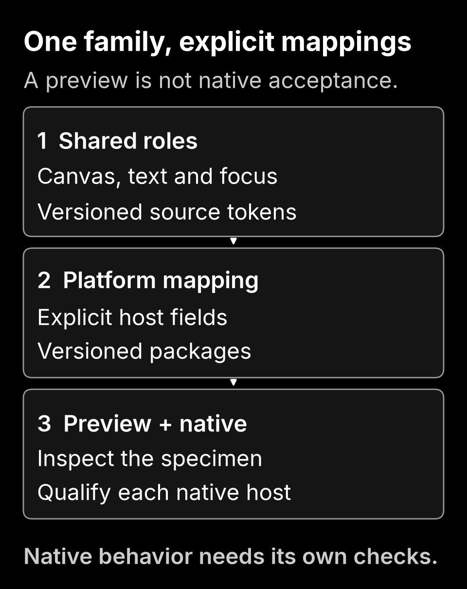

# Clair and Obscur

Clair and Obscur are two appearances built around black and white. Clair uses a white background with black lettering and symbols. Obscur reverses that relationship, with neutral gray for secondary information. The family includes application themes, phone icons and a Garmin watch face candidate.

The current icons, preview and watch source use this palette, with Inter where the host supports it and native font fallbacks elsewhere. Earlier desktop packages keep their accepted colors and versions. Downloads remain previews, and native acceptance depends on the application and exact version.

<a href="https://t92t1914.github.io/clair-obscur-themes/#how-it-works"><picture>
  <source media="(min-width: 900px)" srcset="web/mechanism-obscur-wide.png">
  
</picture></a>

The diagram explains the mechanism, not a native installation result. For example,
the Obscur preview's black canvas and white text do not change Chrome's native UI
font. [Explore the project](https://t92t1914.github.io/clair-obscur-themes/#how-it-works)
or inspect the [figure source and limits](docs/mechanism.md).

Limited earlier Equibop and Chrome 0.1.1 observations do not establish complete native interface or typography coverage. Chrome switching, removal and cleanup remain open. The webpage specimen is not an application screenshot. The [compatibility and acceptance record](docs/acceptance.md) separates observed behavior from checks still open.

[Read in another language](https://github.com/T92T1914/T92T1914/blob/main/TRANSLATION.md).

## Choose your theme

Open the [live preview and downloads](https://t92t1914.github.io/clair-obscur-themes/) to compare Clair and Obscur and choose a package for your application. The page includes installation and restoration steps, source and checksums. All downloads are labeled as previews while native acceptance remains open. The original Chrome and Equicord 0.1.1 files and Firefox, Vencord and BetterDiscord 0.2.0 retain their accepted bytes. The current Clair Equicord choice is a separate 0.1.2 focus correction. New Vivaldi and Opera GX adapters are 0.3.0 candidates. Edge and Brave reuse the original Chrome ZIP. [Platform contracts and remaining acceptance](docs/platform-portability.md).

| Application | Clair | Obscur | Typography |
| --- | --- | --- | --- |
| Google Chrome | Warm light browser colors | Deep neutral browser colors | Chrome keeps its native UI font |
| Equibop with Equicord | Use with native Light appearance | Use with a native dark appearance | Installed Inter 400, 600 and 700, with genuine italics |
| Firefox desktop | Manual warm light static theme | Manual deep neutral static theme | Native browser font, unsigned 0.2.0 candidate |
| Microsoft Edge | Original Chrome artifact for native testing | Original Chrome artifact for native testing | Native browser font, native acceptance pending |
| Brave desktop | Original Chrome artifact for native testing | Original Chrome artifact for native testing | Native browser font, host surfaces unverified |
| Vivaldi desktop | Shareable color settings | Shareable color settings | Native font, import and derived colors unverified |
| Opera GX desktop | Light appearance in one paired package | Dark appearance in the same package | HSL colors derived by the host, loading and contrast unverified |
| Vencord | CSS with native Light appearance | CSS with native dark appearance | Local Inter and system fallback, separate client checks pending |
| BetterDiscord | CSS with native Light appearance | CSS with native dark appearance | Local Inter and system fallback, native check pending |

The Chrome downloads are native color themes, not replacement browsers or website restylers. The Equicord downloads are self contained local CSS files. They preserve code fonts, icons, emoji and language fallbacks. Neither platform's theme downloads fonts, runs scripts or collects data.

## Build and try the preview

The [keyboard companion 0.1.0](docs/keyboard-companion.md) adds separate Gboard and Samsung Keyboard recipes, paired illustrative references and a scoped Samsung palette/Quick panel guide. The preview lets you select a keyboard platform and design appearance independently of the page. Its [refined illustration](docs/art-direction.md#keyboard-hierarchy) gives letters the main weight, keeps utility keys readable and distinguishes an example suggestion with bold text and an underline. Those illustration choices add no native keyboard controls. Two optional Gboard backgrounds reuse the original pure white/black PNG bytes. All nine versioned bundle outputs and their guide remain unchanged, with static routes available without JavaScript. It is not a native keyboard/system-theme import, font installer or phone acceptance result. Existing icon APKs, artwork and desktop packages remain separate.

Python 3.11 or newer builds seventeen platform choices with thirteen distinct selected downloads, plus the retained original Clair Equicord file. Edge and Brave reuse the exact Chrome ZIPs. The Vivaldi settings ZIPs are separate from the paired Opera GX mod candidate. From this project directory:

```powershell
python build.py
python build.py --check
python preview.py --output outputs/preview-0.1.1
```

Open the generated `index.html` to compare both palettes and select a platform candidate. Choose a fresh output folder when preserving an earlier preview. These commands generate a local copy. They do not update the published preview.

Reviewed changes merged into `main` publish the checked preview automatically after Linux, Windows and browser CI succeed. Website and documentation updates can advance without replacing the v0.1.1 release. The download page distinguishes the original released source from the current source snapshot.

| Artifact | Output |
| --- | --- |
| Clair for Chrome | `dist/artifacts/Clair-Chrome-0.1.1.zip` |
| Obscur for Chrome | `dist/artifacts/Obscur-Chrome-0.1.1.zip` |
| Current Clair for Equicord | `dist/equicord/Clair-Equicord-0.1.2.theme.css` |
| Original Clair for Equicord | `dist/equicord/Clair.theme.css` |
| Obscur for Equicord | `dist/equicord/Obscur.theme.css` |
| Firefox candidates | `dist/artifacts/Clair-Firefox-0.2.0.xpi` and `dist/artifacts/Obscur-Firefox-0.2.0.xpi` |
| Vencord candidates | `dist/vencord/Clair-Vencord.theme.css` and `dist/vencord/Obscur-Vencord.theme.css` |
| BetterDiscord candidates | `dist/betterdiscord/Clair-BetterDiscord.theme.css` and `dist/betterdiscord/Obscur-BetterDiscord.theme.css` |
| Vivaldi candidates | `dist/artifacts/Clair-Vivaldi-0.3.0.zip` and `dist/artifacts/Obscur-Vivaldi-0.3.0.zip` |
| Opera GX paired candidate | `dist/artifacts/Clair-Obscur-OperaGX-0.3.0.zip` |
| Integrity records | `dist/SHA256SUMS` and `dist/artifact-manifest.json` |

Use a separate Chrome test profile or a recoverable Equicord configuration for either appearance, and keep the remaining native checks in view. In Chrome, extract the ZIP and use **Load unpacked** in `chrome://extensions`. In Equibop, use Equicord's **Open Themes Folder** control and copy the CSS there. Do not paste it over QuickCSS or install another Discord client.

The [installation and removal guide](docs/installation.md) covers the exact steps, theme conflicts, Inter, switching and restoration. Chrome uses **Settings > Appearance > Reset to default** for removal. Equicord restoration means disabling the candidate and restoring the appearance and theme selections recorded before the test. No monitor, HDR or color profile changes are required.

## How it is built

[tokens-monochrome.json](tokens-monochrome.json) holds the current black and white identity for the preview, app icons and watch face. [tokens.json](tokens.json) preserves the earlier desktop and historical icon palette. Each holds named roles for text, surfaces, focus and control states. Small Python generators map those roles to native browser fields and shared client variables. Vivaldi receives five exported colors. Opera GX receives two integer HSL hints per appearance and derives its own palette, so exact source colors and contrast remain a native acceptance question. Narrow Vencord and BetterDiscord adapters handle their own settings switches and brand buttons. The build produces deterministic packages, verifies their contents and refuses to overwrite an output tree that contains unexpected or edited files.

The browser specimen exercises readable components, local font resolution, keyboard interaction, larger text and fallback behavior. It uses an isolated headless browser profile. Those tests help find mistakes in the supplied CSS and preview, but they cannot certify Chrome's tab strip, Equibop's full interface or physical HDR appearance.

Inter verification checks rendered Regular, SemiBold and Bold faces and their genuine italic counterparts. Strict isolated checks observed all six installed faces after a later Windows boot, before font intervention in that continuation. Native Equibop evidence remains narrower. Clair 0.1.2 has scoped observations for five faces, while Bold Italic, complete coverage across both appearances, native code and exact language fallback remain unverified. Earlier restart failures remain in the record, and the later boot observation does not prove permanent persistence. The [acceptance record](docs/acceptance.md#installed-font-investigation) separates these observations and their remaining limits. A readable fallback is a separate result, not a passed Inter check.

See [development and verification](docs/development.md) for reproducible commands, [design](docs/design.md) for the color and typography choices, and [research](research/research.md) for the sources and concerns that informed the native checks. The [publication guide](docs/publication.md) separates a downloadable preview, native acceptance and store approval.

## Watch and phone candidates

The shared palette also supports a [Garmin watch face candidate](docs/garmin-watchface.md)
and [original phone icon artwork](docs/samsung-icons.md). The watch face targets
`fenix9pro47mm`. Version 0.7.0 enlarges the shared Analog hour markers and
hands in both active and always on drawing. The opposite cardinal batons span
436 pixels on the 454-pixel display. Active drawing adds 48 minute strokes
on a nominal 442-pixel outer track, leaving the hour positions to the batons.
Text bands, data fields, native font scaling and the Digital layout stay in
their existing positions. Analog always on keeps its thin gray outlines and
shared gentle shift. Digital keeps its time-only always on view, and a fully
off display stays black. The Inter clock resource from 0.5.0 is unchanged.
Both 0.7.0 programs compiled without warnings for the exact target with
SDK 9.2.0. All 26 annotated target groups compiled and zero executed.
Local pretransfer qualification ran 301 Python tests with 7 skips and no
failures, followed by build, rebuild and palette checks.
The preserved 0.3.0 program passed all 16 of its
simulator test groups for the exact target, with bounded appearance, switching and
always on observations. The broader 0.2.0 history remains separately labeled.
Both 0.5.0 and 0.6.0 normal programs have exact transfer and independent
watch-file readbacks. The active and always on dials were reported too inset
after the 0.6.0 update. The 0.7.0 normal program has now been copied to the
watch and matched both the transfer readback and a separate fresh readback,
with the opaque settings and device identity file unchanged. Those file checks
do not establish watch-side recognition or fit after unplugging. Current
version display, font and menu behavior, switching, always on appearance,
persistence, memory, USB restoration and power use remain open.

The phone gallery's 0.29.0 black and white collection pairs 276 named Android apps with 24 general symbols, giving 300 choices in both appearances. Delta's facets, American's separated wing forms, Southwest's segmented heart, Wikipedia's open serif W and Earth's layered sphere replace more general travel or reference metaphors. The [art-direction comparison](docs/art-direction.md) explains the selected outline, solid and hybrid treatments and their small-size compromises. Ten SVGs change from 0.28.0, while the other 590 retain their exact bytes. The earlier [Claude and Perplexity refinements](docs/icon-identity.md) and retained ChatGPT decision stay intact. A local finder searches names, icon IDs and Android package IDs, with separate app/function filters. Both appearances stay together, and the full catalog remains available without JavaScript. Exact official store links and package hints distinguish similar products. All twenty-eight earlier archives remain unchanged, and all 29 revisions support the local PNG exporter. Coverage is a selection, not a complete store catalog or a popularity chart. Human recognition, launcher masking and phone acceptance remain separate.

The hosted gallery can prepare an individual PNG at 512 pixels beside either appearance. It uses the corresponding local SVG in your browser, with no upload or phone installation. The extracted preview opened as a local file keeps the SVG downloads and full instructions for exporting from source because browser origin restrictions prevent that canvas export. The existing exporter still produces every icon at 512 and 1024 pixels.

The maintained [Android icon-pack path](docs/android-iconpack.md) now targets the 0.29.0 drawings. Clair Icons 0.1.2/code 3 selects the 300 Clair images and a light application surface. Its package identity is `io.github.t92t1914.clairicons`, separate from Obscur Icons 0.1.13/code 14 at `io.github.t92t1914.obscuricons`. Obscur remains the default build appearance. Package versions are independent from the artwork version. The qualified export changes twenty PNGs and preserves the exact bytes of the other 1,180 PNGs. Verify each resulting APK's resources and signature before private delivery.

Both configurations retain the same 1,354 ordered component mappings and 290 exact public package queries. The mappings include the historical communication, video-editor and Gboard declarations and eleven separately observed launcher aliases. Twelve named packages still have no qualified alias. The local coverage check stays limited to supported package names, with no requested permissions or network reporting. Accepted Clair 0.1.1, Obscur 0.1.12 and earlier APKs remain preserved, and signed Android packages stay on the existing private delivery route.

Distinct package identities and compiled light/dark resources do not establish installation together, launcher recognition or Theme Park assignment. User-reported installation and partial application of the original Obscur 0.1.0 remain dated evidence. A later phone check must inspect each pack, a new separate Theme Park draft, both displays, masking, labels and restoration. Neither pack supplies a Samsung system theme, keyboard theme, system font or autocorrect change.

A scoped Samsung Theme Park check saved and applied a local ObscurBW icon theme, with its selection checkmark observed. That pack combined one earlier general drawing, one 0.6.0 named drawing and neutral fallback artwork. It does not establish assignment of the full collection or the later 0.7.0 through 0.17.0 additions. Actual launcher masking, labels, phone fonts, switching and restoration remain separate checks.

## Report a problem

Include the theme and application versions, native Light or Dark setting, the affected surface and the steps that reproduce it. For Equicord, mention relevant theme or font overrides without exporting your full settings. Crop private names and messages from any screenshots. A missing glyph, unreadable code block or ambiguous switch state is useful evidence even when the rest of the interface looks right.

Original source, documentation and generated theme assets use the [MIT license](LICENSE). The Android component table carries its included [Apache 2.0 attribution](docs/android-iconpack-sources.md). Inter is installed separately from its [official distribution](https://rsms.me/inter/). No third party theme implementation or font binary is bundled.
