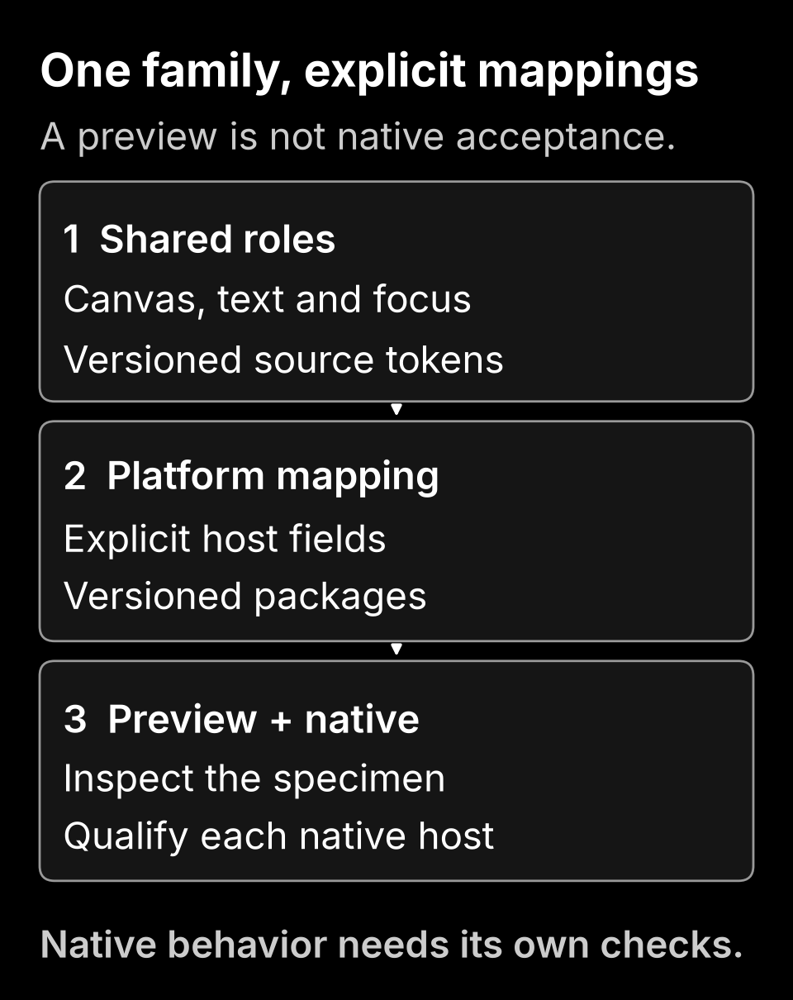

# Clair and Obscur

Clair and Obscur are two appearances built around black and white. Clair uses a white background with black lettering and symbols. Obscur reverses that relationship, with neutral gray for secondary information. The family includes application themes, phone icons and a Garmin watch face candidate.

The current icons, preview and watch source use this palette, with Inter where the host supports it and native font fallbacks elsewhere. Earlier desktop packages keep their accepted colors and versions. Downloads remain previews, and native acceptance depends on the application and exact version.

<a href="https://t92t1914.github.io/clair-obscur-themes/#how-it-works"><picture>
  <source media="(min-width: 900px)" srcset="web/mechanism-obscur-wide.png">
  
</picture></a>

The diagram explains the mechanism, not a native installation result. For example,
the Obscur preview's black canvas and white text do not change Chrome's native UI
font. [Explore the project](https://t92t1914.github.io/clair-obscur-themes/#how-it-works)
or inspect the [figure source and limits](docs/mechanism.md).

Limited earlier Equibop and Chrome 0.1.1 observations do not establish complete native interface or typography coverage. Chrome switching, removal and cleanup remain open. The webpage specimen is not an application screenshot. The [compatibility and acceptance record](docs/acceptance.md) separates observed behavior from checks still open.

[Read in another language](https://github.com/T92T1914/T92T1914/blob/main/TRANSLATION.md).

## Choose your theme

Open the [live preview and downloads](https://t92t1914.github.io/clair-obscur-themes/) to compare Clair and Obscur and choose a package for your application. The page includes installation and restoration steps, source and checksums. All downloads are labeled as previews while native acceptance remains open. The original Chrome and Equicord 0.1.1 files and Firefox, Vencord and BetterDiscord 0.2.0 retain their accepted bytes. The current Clair Equicord choice is a separate 0.1.2 focus correction. New Vivaldi and Opera GX adapters are 0.3.0 candidates. Edge and Brave reuse the original Chrome ZIP. [Platform contracts and remaining acceptance](docs/platform-portability.md).

| Application | Clair | Obscur | Typography |
| --- | --- | --- | --- |
| Google Chrome | Warm light browser colors | Deep neutral browser colors | Chrome keeps its native UI font |
| Equibop with Equicord | Use with native Light appearance | Use with a native dark appearance | Installed Inter 400, 600 and 700, with genuine italics |
| Firefox desktop | Manual warm light static theme | Manual deep neutral static theme | Native browser font, unsigned 0.2.0 candidate |
| Microsoft Edge | Original Chrome artifact for native testing | Original Chrome artifact for native testing | Native browser font, native acceptance pending |
| Brave desktop | Original Chrome artifact for native testing | Original Chrome artifact for native testing | Native browser font, host surfaces unverified |
| Vivaldi desktop | Shareable color settings | Shareable color settings | Native font, import and derived colors unverified |
| Opera GX desktop | Light appearance in one paired package | Dark appearance in the same package | HSL colors derived by the host, loading and contrast unverified |
| Vencord | CSS with native Light appearance | CSS with native dark appearance | Local Inter and system fallback, separate client checks pending |
| BetterDiscord | CSS with native Light appearance | CSS with native dark appearance | Local Inter and system fallback, native check pending |

The Chrome downloads are native color themes, not replacement browsers or website restylers. The Equicord downloads are self contained local CSS files. They preserve code fonts, icons, emoji and language fallbacks. Neither platform's theme downloads fonts, runs scripts or collects data.

## Build and try the preview

The [keyboard companion 0.1.0](docs/keyboard-companion.md) adds separate Gboard and Samsung Keyboard recipes, paired illustrative references and a scoped Samsung palette/Quick panel guide. The preview lets you select a keyboard platform and design appearance independently of the page. Its [refined illustration](docs/art-direction.md#keyboard-hierarchy) gives letters the main weight, keeps utility keys readable and distinguishes an example suggestion with bold text and an underline. Those illustration choices add no native keyboard controls. Two optional Gboard backgrounds reuse the original pure white/black PNG bytes. All nine versioned bundle outputs and their guide remain unchanged, with static routes available without JavaScript. It is not a native keyboard/system-theme import, font installer or phone acceptance result. Existing icon APKs, artwork and desktop packages remain separate.

Python 3.11 or newer builds seventeen platform choices with thirteen distinct selected downloads, plus the retained original Clair Equicord file. Edge and Brave reuse the exact Chrome ZIPs. The Vivaldi settings ZIPs are separate from the paired Opera GX mod candidate. From this project directory:

```powershell
python build.py
python build.py --check
python preview.py --output outputs/preview-0.1.1
```

Open the generated `index.html` to compare both palettes and select a platform candidate. Choose a fresh output folder when preserving an earlier preview. These commands generate a local copy. They do not update the published preview.

Reviewed changes merged into `main` publish the checked preview automatically after Linux, Windows and browser CI succeed. Website and documentation updates can advance without replacing the v0.1.1 release. The download page distinguishes the original released source from the current source snapshot.

| Artifact | Output |
| --- | --- |
| Clair for Chrome | `dist/artifacts/Clair-Chrome-0.1.1.zip` |
| Obscur for Chrome | `dist/artifacts/Obscur-Chrome-0.1.1.zip` |
| Current Clair for Equicord | `dist/equicord/Clair-Equicord-0.1.2.theme.css` |
| Original Clair for Equicord | `dist/equicord/Clair.theme.css` |
| Obscur for Equicord | `dist/equicord/Obscur.theme.css` |
| Firefox candidates | `dist/artifacts/Clair-Firefox-0.2.0.xpi` and `dist/artifacts/Obscur-Firefox-0.2.0.xpi` |
| Vencord candidates | `dist/vencord/Clair-Vencord.theme.css` and `dist/vencord/Obscur-Vencord.theme.css` |
| BetterDiscord candidates | `dist/betterdiscord/Clair-BetterDiscord.theme.css` and `dist/betterdiscord/Obscur-BetterDiscord.theme.css` |
| Vivaldi candidates | `dist/artifacts/Clair-Vivaldi-0.3.0.zip` and `dist/artifacts/Obscur-Vivaldi-0.3.0.zip` |
| Opera GX paired candidate | `dist/artifacts/Clair-Obscur-OperaGX-0.3.0.zip` |
| Integrity records | `dist/SHA256SUMS` and `dist/artifact-manifest.json` |

Use a separate Chrome test profile or a recoverable Equicord configuration for either appearance, and keep the remaining native checks in view. In Chrome, extract the ZIP and use “Load unpacked” in `chrome://extensions`. In Equibop, use Equicord's “Open Themes Folder” control and copy the CSS there. Do not paste it over QuickCSS or install another Discord client.

The [installation and removal guide](docs/installation.md) covers the exact steps, theme conflicts, Inter, switching and restoration. Chrome uses “Settings > Appearance > Reset to default” for removal. Equicord restoration means disabling the candidate and restoring the appearance and theme selections recorded before the test. No monitor, HDR or color profile changes are required.

## How it is built

[tokens-monochrome.json](tokens-monochrome.json) holds the current black and white identity for the preview, app icons and watch face. [tokens.json](tokens.json) preserves the earlier desktop and historical icon palette. Each holds named roles for text, surfaces, focus and control states. Small Python generators map those roles to native browser fields and shared client variables. Vivaldi receives five exported colors. Opera GX receives two integer HSL hints per appearance and derives its own palette, so exact source colors and contrast remain a native acceptance question. Narrow Vencord and BetterDiscord adapters handle their own settings switches and brand buttons. The build produces deterministic packages, verifies their contents and refuses to overwrite an output tree that contains unexpected or edited files.

The browser specimen exercises readable components, local font resolution, keyboard interaction, larger text and fallback behavior. It uses an isolated headless browser profile. Those tests help find mistakes in the supplied CSS and preview, but they cannot certify Chrome's tab strip, Equibop's full interface or physical HDR appearance.

Inter verification checks rendered Regular, SemiBold and Bold faces and their genuine italic counterparts. Strict isolated checks observed all six installed faces after a later Windows boot, before font intervention in that continuation. Native Equibop evidence remains narrower. Clair 0.1.2 has scoped observations for five faces, while Bold Italic, complete coverage across both appearances, native code and exact language fallback remain unverified. Earlier restart failures remain in the record, and the later boot observation does not prove permanent persistence. The [acceptance record](docs/acceptance.md#installed-font-investigation) separates these observations and their remaining limits. A readable fallback is a separate result, not a passed Inter check.

See [development and verification](docs/development.md) for reproducible commands, [design](docs/design.md) for the color and typography choices, and [research](research/research.md) for the sources and concerns that informed the native checks. The [publication guide](docs/publication.md) separates a downloadable preview, native acceptance and store approval.

## Watch and phone candidates

The current watch source is the [0.12.0 black-dial redesign candidate](docs/garmin-redesign.md).
It changes Hybrid's ceramic bezel, filled numerals, applied markers, moving hand
proportions, typography and data placement. Original production dial artwork stays
separate from native moving hands and readings. Digital time sits below the pivot,
the day aperture stays at three, and battery sits above the pivot. Weather and
steps retain their exact values and status. The printed scale is a visual reference,
not a dive timer.

The accepted 0.12.0 normal program has a verified physical transfer and
user-reported activation and normal operation. The [qualification matrix](docs/garmin-watchface.md#0120-native-qualification-in-progress)
keeps that report separate from simulator measurements and untested physical behavior.

The shared palette also supports a [Garmin watch face candidate](docs/garmin-watchface.md)
and [original phone icon artwork](docs/samsung-icons.md). The [matched native 10:10 comparison](docs/garmin-redesign.md#matched-native-comparison)
shows the retained 0.11.0 baseline beside the final 0.12.0 normal program on the
exact 454-pixel SDK target. Both face-only images use the same synthetic values.
They show the change in bezel, markers, hands and information placement without
claiming physical-watch appearance or universal readability.

Retained 0.12.0 active samples cover both appearances, enlarged text, long step
counts, unavailable weather and charging. The exact 03:02 clock ink grows from
50 by 19 to 60 by 23 pixels at scale 1.35. The enlarged 06:30 pose retains readable
time and recognizable hands, with weather-status text crossing the divided head.
The [retained failures and correction](docs/garmin-redesign.md#native-findings-and-current-limits)
explain the one-pixel glyph separator and transparent text backgrounds. The earlier
measured-row/hand-contour policy remains historical.

The final matching diagnostic reports 42 passes, zero failures and zero errors,
while its Java process exits 1. The unexplained exit remains part of the result.
An earlier diagnostic's null-assertion API error was corrected without dropping
its seven invalid-input cases. Analog/Digital active rendering, saved choices,
providers and the Digital Inter resource preserve their contracts.

The first complete Hybrid AOD sequence met its sampled area bound but retained
34 and 36 lit pixels across consecutive four-frame windows. The exact simulator
target reports that this temporal protection rule applies. All three sparse AOD
paths now finish with a rotating black-column pass. Five corrected native frames
show zero four-frame intersections and recognizable sparse hands, with some outline
segments intentionally absent during a phase. The [current matrix](docs/garmin-watchface.md#0120-native-qualification-in-progress)
keeps that failure, French SDK locale limits, bounded memory/persistence observations,
scoped restoration and physical-watch use separate.

The retained normal 0.10.0 program is 42,076 bytes and its diagnostic program is 204,636
bytes. Both compile for the exact `fenix9pro47mm` target with SDK 9.2.0. The focused
host suite ran 60 tests: 58 passed and two original-font checks skipped. The exact
diagnostic subsequently reported all 42 target groups passed, with zero failures
or errors, although its Java runner returned exit code 1. Three qualification
runs of the unchanged normal program completed with exit code 0. Native captures
cover both appearances, ordinary and enlarged text, and a controlled 03:15
comparison with 0.9.0. Current always-on rasters, a memory sample and one normal
restart provide bounded simulator evidence. Physical-watch use, complete locale
and stress coverage, sustained runtime and earlier USB restoration remain open.
The observed Vietnamese SDK date limitation and runner anomaly are retained in the
[0.10.0 qualification](docs/garmin-watchface.md#current-0100-qualification).
Those results do not qualify the changed 0.11.0 renderer. Its [candidate scope and
pending checks](docs/garmin-watchface.md#0110-readability-candidate) keep source,
compiler, simulator and physical evidence separate.

The preserved 0.9.0 program passed 38 target simulator groups and has bounded
appearance, enlarged-text, always-on and restart observations. Its 39,788-byte
normal program was transferred and independently read back, without establishing
physical activation or fit. Its visual direction was subsequently selected for
redesign. The [version-specific history](docs/garmin-watchface.md#preserved-090-qualification)
retains those results and restoration limits. They do not qualify 0.10.0.

The preserved 0.8.0 programs compiled for the exact target and passed all 32
annotated simulator groups. Its bounded menu, font-scale, always-on, memory and
normal-restart observations remain [recorded history](docs/garmin-watchface.md#preserved-080-qualification).
The 0.8.0 visual direction was subsequently rejected against the requested diver
reference. One transfer and two exact watch-file readbacks did not establish
watch-side activation, fit or live providers. Earlier 0.7.0 and other programs
retain their own source, test and transfer records. Physical acceptance and the
earlier Garmin USB-mode restoration remain open.

The phone gallery's 0.33.0 black and white collection pairs 276 named Android apps with 24 general symbols, giving 300 choices in both appearances. A [focused refinement](docs/icon-craft.md#fold-clearance-refinement-artwork-0330) widens Proton VPN's fold separator after small-size and mixed-context comparisons. Two SVGs change and the other 598 retain their exact 0.32.0 bytes, including the accepted My Spectrum, Wallpaper Engine and Pinterest refinements. All 32 earlier archives remain preserved, including the completed 184-drawing refinement in 0.30.0. A local finder searches names, icon IDs and Android package IDs, with separate app/function and mapping filters. Both appearances stay together, and the full catalogue remains available without JavaScript. Exact official store links and package hints distinguish similar products. Coverage is a selection, not a complete store catalogue or popularity chart. Human recognition, launcher masking and phone acceptance remain separate.

Each gallery card also distinguishes “Mapping included” from “No exact mapping recorded,” deriving the label from the maintained Android declarations. The Pack mapping filter combines with name, icon ID, package search and the app/function filter. The 277 choices with declarations and 23 manual-selection choices have separate short application routes, available without JavaScript. A declared mapping does not prove that an installed app, launcher or saved Theme Park theme uses it. The twelve named-package gaps retain artwork and a manual route.

The hosted gallery can prepare an individual PNG at 512 pixels beside either appearance. It uses the corresponding local SVG in your browser, with no upload or phone installation. The extracted preview opened as a local file keeps the SVG downloads and full instructions for exporting from source because browser origin restrictions prevent that canvas export. The existing exporter still produces every icon at 512 and 1024 pixels.

The maintained [Android icon-pack path](docs/android-iconpack.md) targets the 0.33.0 drawings. Clair Icons 0.1.6/code 7 selects the 300 Clair images and a light application surface. Its package identity is `io.github.t92t1914.clairicons`, separate from Obscur Icons 0.1.17/code 18 at `io.github.t92t1914.obscuricons`. Obscur remains the default build appearance. A completed coverage report can survive an Android configuration recreation through a transient text snapshot, without saving an app inventory to disk or starting another scan. A synthetic JVM regression exercises the actual Activity code. Physical folding and phone application remain separate checks. Package versions are independent from the artwork version. Verify each resulting APK's resources and signature before private delivery.

Both configurations use 1,355 ordered component mappings and 290 exact public package queries. The existing 1,354-row sequence is preserved, with one exact Domino's launcher activity appended from an October 29, 2026 local coverage observation. It adds no query or permission. The twelve separately observed aliases comprise eleven from October 21 and this one addition. The same twelve named packages still have no qualified alias. The local coverage check stays limited to supported package names, with no requested permissions or network reporting. The observation identifies one missing component. The update's installed coverage and Theme Park assignment still require their own checks. Accepted Clair 0.1.4, Obscur 0.1.15 and earlier APKs remain preserved, and signed Android packages stay on the existing private delivery route.

Distinct package identities and compiled light/dark resources do not establish installation together, launcher recognition or Theme Park assignment. User-reported installation and partial application of the original Obscur 0.1.0 remain dated evidence. A later phone check must inspect each pack, a new separate Theme Park draft, both displays, masking, labels and restoration. Neither pack supplies a Samsung system theme, keyboard theme, system font or autocorrect change.

A scoped Samsung Theme Park check saved and applied a local ObscurBW icon theme, with its selection checkmark observed. That pack combined one earlier general drawing, one 0.6.0 named drawing and neutral fallback artwork. It does not establish assignment of the full collection or the later 0.7.0 through 0.17.0 additions. Actual launcher masking, labels, phone fonts, switching and restoration remain separate checks.

## Report a problem

Include the theme and application versions, native Light or Dark setting, the affected surface and the steps that reproduce it. For Equicord, mention relevant theme or font overrides without exporting your full settings. Crop private names and messages from any screenshots. A missing glyph, unreadable code block or ambiguous switch state is useful evidence even when the rest of the interface looks right.

Original source, documentation and generated theme assets use the [MIT license](LICENSE). The Android component table carries its included [Apache 2.0 attribution](docs/android-iconpack-sources.md). Inter is installed separately from its [official distribution](https://rsms.me/inter/). No third party theme implementation or original TTF/OTF file is bundled. The Garmin Digital layout includes its documented, licensed derived bitmap clock resource.
