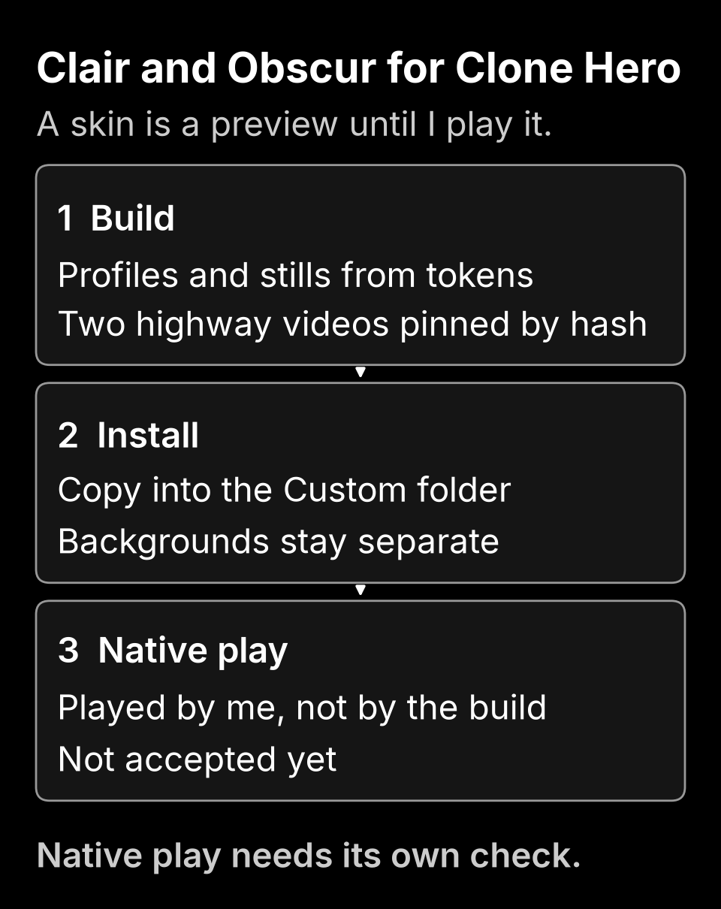

# Clone Hero skin

The Clone Hero 0.1.0 candidate carries Clair and Obscur into the game. It has four color profiles, two video highways and two still highways. It is a separate candidate with its own version and identities. No existing package changes.

<picture>
  <source media="(min-width: 900px)" srcset="images/clone-hero-obscur-wide.png">
  
</picture>

The figure is drawn on Obscur by the same renderer as the [mechanism figure](mechanism.md). Its source is [clone-hero-figure.json](clone-hero-figure.json) and its receipt is [clone-hero-rendering.json](clone-hero-rendering.json). Run `python tools/render_clonehero_figure.py --check` to compare the receipt.

## What the skin looks like

Clair and Obscur are black and white. Obscur draws white notes on a black highway. Clair draws black notes on a light one. Open notes are the muted gray of each theme, and star power is vivid red, `#FF0000`.

`Clair Color` and `Obscur Color` use full strength lane colors at the hues of the theme roles, with yellow as the one added hue. They keep the theme ink for star power, because red star power would look the same as the red lane.

All four profiles start from a recorded base of the game's own color keys and change only what the skin is about. Every profile carries the same 183 keys in the same order as a complete professional profile, so the game reads them the way it reads that profile. HOPO and tap markers on six fret stay gray, so red keeps meaning star power and nothing else.

The rails match the reference RGB highway. Each is 20 solid pixels wide with a glow about 40 pixels across. Along a rail, star power red and the theme ink trade places, so the skin has one color. Both highways are fully opaque.

## What is in the package

| Path | Purpose |
| --- | --- |
| `Colors/Clair.ini`, `Colors/Obscur.ini` | The black and white profiles |
| `Colors/Clair Color.ini`, `Colors/Obscur Color.ini` | The full strength lane profiles |
| `Video Highways/<Name>/highway.webm` and `config.ini` | A two second VP8 loop at 512 by 1024, 60 frames at 30 per second |
| `Highways/<Name> Still.png` | The first frame of the loop as a still highway |
| `LICENSE.txt` | The MIT grant to retain when sharing |
| `Clair-Obscur-Clone-Hero-0.1.0.zip` | The same tree in a deterministic archive |
| `manifest.json`, `SHA256SUMS` | Token mapping and file identities |

The two `highway.webm` files are committed under `themeforge/clonehero_assets` as pinned source assets. They are the bytes installed in my game folder, and the encode needs `ffmpeg` and the VP8 encoder, which this repository does not require. The generator checks their SHA-256 values every time it reads them and refuses a changed file.

| File | SHA-256 |
| --- | --- |
| Clair `highway.webm` | `f3fdafce55e4d18bc707fac71f2f188b2102645dcd6d22749fe1a6995ba05ede` |
| Obscur `highway.webm` | `f86caa353032f1456d3cdbb249dec4d9151bb9dc4a195d557667d1428a0cf439` |

Everything else is built with the Python standard library only.

## Backgrounds

The video background is a 40 second loop on true black, with a soft key light from the upper left, dust in the light and a red ember low on each side. The middle left stays dark for the highway. It is encoded at the highest VP8 quality setting, because any lower setting removes the dither and the dark falloff bands. There is a 4K file and a 1080p copy.

The background videos are not in this repository or in the package. Check a copy of yours against these values:

| File | SHA-256 |
| --- | --- |
| `Clair Obscur 4K.webm` | `6574b87ec9dc70bf173c1f231ba0dd5807746a7d487ff7a86667cf233756a986` |
| `Clair Obscur 1080p.webm` | `91aa67bce6561a7e9455b2735e5eb3d77ebc318cbe10b6a6845ca6bac868fcd1` |

## Build and inspect

From this repository, use Python 3.11 or newer:

```powershell
python -m themeforge.clonehero --output outputs/clone-hero-01
python -m themeforge.clonehero --output outputs/clone-hero-01 --check
```

Use a new output directory for a new build. The first command preserves any existing destination instead of overwriting it. The check compares every generated byte and required path without repairing a changed output.

## Install by hand

Verify the ZIP against `SHA256SUMS` from the same build, extract it into an owned folder, and copy the `Colors`, `Video Highways` and `Highways` folders into the `Custom` folder of your Clone Hero data. Do not replace a profile of yours that has the same name. Select a profile in the game's color settings and a highway in its highway settings.

## What has and has not been checked

The generator rebuilds the four profiles byte for byte, the two config files byte for byte and the two stills pixel for pixel against the skin installed in my game folder. The unit tests pin those results. They also check the 183 keys and their order, that each color profile has five distinct lanes at full saturation and value, that the pinned videos are VP8 at 512 by 1024, and that the loop source repeats at frame 60. A decode of the two pinned videos gave 60 frames each, and the mean change from the last frame to the first was inside the range of the other steps for Obscur and 7 percent above the largest of them for Clair, at 0.46 against 0.43 on a 255 scale. I read that as encoder noise and not a visible jump, but I have not watched the loop in the game.

None of this is native play. Loading the profiles, the highways and the backgrounds in the game, and a full chart with star power all remain `deferred-shared-pc` and are mine to check. The PNG files match in pixels but not necessarily in bytes, because a compressor may differ between systems. The same goes for the ZIP, the manifest and the checksums that hold them, so compare a build with its own output from the same system. A fixture or a page check is never called acceptance here.
