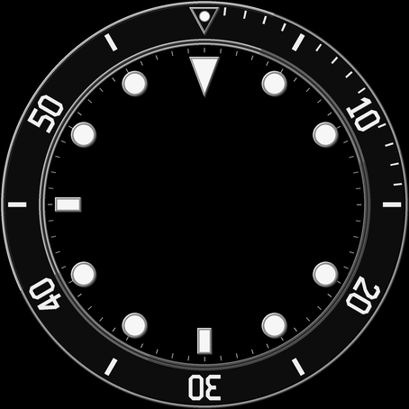
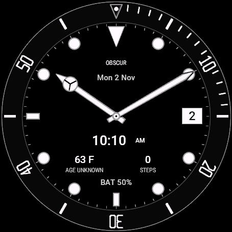
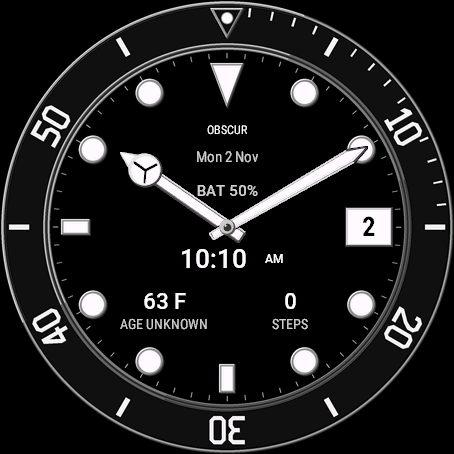

# Black-dial redesign candidate 0.12.0

Version 0.12.0 substantially changes the existing Hybrid composition on the exact fenix9pro47mm, 454 by 454 AMOLED target. The new fixed dial uses a substantial ceramic bezel, filled original numerals, applied markers and narrow directional steel edges. Moving hands, date and all useful readings remain in the real Monkey C renderer.

This image is the actual production backplate, not a simulator screenshot or a complete watch face. It contains no frozen time, date, manufacturer photograph or branding. The paired Clair resource uses the exact white canvas from the shared tokens. The supplied reference photographs remain private references.

## Matched native comparison

These are actual 454 by 454 SDK captures for `fenix9pro47mm`, not reconstructed previews. Both show Obscur Hybrid at November 2, 10:10 AM, English, 12-hour format, font scale 1.00, 63 F with `AGE UNKNOWN`, zero steps and BAT 50%. The images are unchanged face-only captures with synthetic data. The [comparison provenance](images/garmin-redesign-012/provenance.json) binds each image to its normal program and scene without private paths.

| Retained 0.11.0 baseline | Current 0.12.0 normal program |
| --- | --- |
|  |  |

Independent inspection found stronger material edges, filled bezel numerals, more substantial markers and a clearer arrangement of battery and digital time. Both hands remain continuous and every useful reading is complete at this pose. This is a bounded native comparison, not proof of every crossing, physical wrist appearance or a manufacturer-identical watch. The earlier production-backplate image contains no hands or data and remains a different evidence class.

## Composition

The bezel uses original filled numeral polygons and explicit counters instead of the previous thin line glyphs. Larger luminous markers have restrained upper-left highlights and darker opposing rims. The native hour hand is shorter and broader, with a divided circular head, luminous inset and directional edges. The minute hand remains visibly longer. A small polished center pin replaces the previous bullseye treatment.

Digital time sits below the pivot, inside x165..289, y238..280 and the divided head's inner sweep. Its digits and separate AM/PM region share a 42-pixel vertical band. The main clock font candidates are `[30, 28, 26, 24, 22, 20, 18, 16]` before applying the device scale. Weather and steps occupy y282..338, while the 118-pixel battery band sits above the pivot at y176..206. The live day aperture at three remains x346..392, y208..246, outside the head's outer sweep. The calendar retains its existing format choices and y145..170 band. Actual font fitting can still choose a smaller candidate, so requested scale alone does not establish meaningful enlargement.

The active renderer draws the complete hands and center pin before the useful readings. Each reading then draws eight canvas-colored copies of its glyphs at the neighboring one-pixel offsets, followed by its foreground glyphs. Both stages use `Graphics.COLOR_TRANSPARENT` for the text background. This protects the glyph boundary without clearing a rectangular row or repainting a hand contour over the final text. The day aperture retains its small opaque inset and is drawn last. Branding stays behind the hands without glyph protection.

This deliberately replaces the measured-row and contour policy from 0.11.0 after adverse native results. It keeps information in fixed positions, but it cannot make every hand crossing disappear. A reading can cross a hand or its divided head, and a bright hand can remain visible through a numeral's counter. Judge those intersections in the actual target image, including zero, six, eight and nine. Branding may be covered. The result is an original diver interpretation, not a claim of a manufacturer-identical watch.

The design uses the existing Hybrid selection, not a hidden new mode. Valid saved Analog or Digital selections survive an update. The existing watch settings menu displays the layout and program version together. Select Hybrid and Obscur to inspect this black-dial candidate during an authorized native session.

## Production artwork and native behavior

The generator is [generate_dial_art.py](../garmin/generate_dial_art.py). It reads the real model's marker dimensions and the monochrome canvas tokens. Both PNGs, the generator, model and token inputs have exact identities in [the resource provenance](../garmin/watchface/resources/dial/provenance.json). The numeral contours are original artwork and contain no external font.

Normal builds consume committed resources without Pillow and reject stale source/resource identities before compilation. Regeneration uses the existing Pillow 12.3.0 environment:

    python garmin/generate_dial_art.py --check
    python garmin/generate_dial_art.py --write

The writer preserves edited, incomplete or foreign output. The native renderer holds graphics-pool bitmap references loaded outside the update handler. It does not lock their underlying objects with get() or allocate a full-screen application-heap buffer. Resource inspection does not establish runtime memory or power consumption.

Hybrid AOD intentionally shares the revised hand and marker silhouettes. It remains a separate sparse outline treatment on black, with the four-phase shift and no active plate, bright bezel, data or filled material. The first complete native cycle stayed below 2% sampled lit area but retained 34 and 36 pixels through consecutive four-frame windows. An actual target probe confirmed that burn-in protection is required, making this a temporal failure. The corrected source ends all three sparse AOD branches with a rotating black-column pass, clearing `x % 4 == minute % 4` after each painter. Fine segments can disappear during a phase. Five actual corrected Hybrid frames cover phases 0, 1, 2, 3, 0 with zero intersections across both four-frame windows, no lit pixels outside the defined circle and about 1.477% to 1.555% sampled lit area. Independent inspection found recognizable sparse hands and markers with phase-specific segment gaps. The operator observed continuous time and active wake. This bounded cycle result does not establish every minute, a final-byte Off sample, battery life or physical display protection. The [maintained qualification](garmin-watchface.md#always-on-failure-and-correction) retains the counts, applicable contract and current limits.

Analog/Digital, saved layout IDs, providers, precise values, weather freshness distinctions, charging state and the Digital Inter resource keep their contracts. No seconds hand, additional timer, permission, service or device setting is introduced.

## Native findings and current limits

Actual SDK execution exposed three separate overlap failures, all retained with their captures:

- The first upper clock used a solid rectangular field. At 10:10 it interrupted both hand silhouettes and detached the divided hour-head cue. Moving the clock below the pivot corrected that specific presentation pose.
- At 06:30 with font scale 1.35, the lower measured rows and repainted contours still cut through digital time, weather-age text, the divided head and battery. That adverse pose failed visual acceptance despite successful source checks. The paired 03:02 captures also showed the clock shrinking from 50 by 19 to 47 by 18 visible pixels when the requested scale increased, motivating the larger clock band and reserved font headroom.
- The first glyph-separator candidate removed explicit row rectangles, but `drawText` still painted an opaque background because the canvas was passed as its background color. A second 06:30 capture retained the rectangular hand segmentation. Both text stages now use a transparent background; checking only for the absence of `fillRectangle` was insufficient.

An independent reviewer accepted the first transparent-background Obscur 06:30, scale 1.35 SDK capture as a bounded usable result. The filled minute hand remained continuous, digital time was legible, the divided hour head remained identifiable and BAT 50% had a clear upper position. `AGE UNKNOWN` still crossed the divided head and competed with it, but the full status was readable. That historical normal program is 461,804 bytes, SHA-256 `9f83f84779c6651cd5df1696edb676ab334e6759f87f9dff62d57c6759f4b11b`. Its private SDK image is identified by SHA-256 `18f2795525ed4f92ef11366f5459cc5e7d8c38d77a047d7fa446cd250875eb43`.

That iteration's size-26 starting candidate enlarged the 03:02 clock from 43 by 16 to 57 by 22 visible pixels, but reduced the ordinary clock to 16 pixels high. The next active-view sample program restored the primary 30/28 candidates within the taller band. Its actual 03:02 clock measures 50 by 19 at scale 1.00 and 60 by 23 at 1.35. Its enlarged 06:30 image also received bounded independent acceptance with the same weather-status/head crossing tradeoff. The final normal program preserves that active renderer and adds the AOD correction. The earlier captures retain their own program identity; the new final 10:10 image is shown above. The [current program identities and qualification matrix](garmin-watchface.md#0120-native-qualification-in-progress) distinguish these results from the retained intermediate programs. They do not establish every string, pose, appearance or physical wrist result.

The current source regressions require the eight one-pixel offsets, transparent backgrounds for both text stages, foreground after the separator, complete hands before useful readings and no later contour repaint. Negative controls reject the observed opaque backgrounds and row rectangles as well as missing neighbors, a larger separator, missing foreground, early text and disabled protection. These checks bind the implementation; they do not render Garmin glyphs or establish visual acceptance.

## Acceptance still required

Native evidence now includes the final matched 10:10 pair and earlier active-renderer samples at ordinary/enlarged 03:02, noon, 03:15/day 8, 06:30, 09:45/day 28 and French ISO/long-step states in both appearances. A separate enlarged Clair sample covers charging at 100% and unavailable weather. These inspected poses do not qualify every string, value, appearance or hand crossing. A truly missing native step provider remains unestablished.

French abbreviated December fails in the installed SDK. A private probe logged the malformed raw Gregorian string before application composition. The existing ISO choice works in inspected samples but does not repair the abbreviation or establish physical firmware behavior. One ordinary stop/reload preserved the earlier sample program's Clair/Hybrid and ISO selections before repair. Its bounded memory-panel observation remains version-specific, with no numeric graphics-pool measurement or sustained-memory claim.

The final diagnostic reports 42 semantic passes, zero failures and zero errors with Java exit 1 and empty stderr. That unresolved exit remains separate from the semantic result. The preceding diagnostic's 41-pass/one-error result came from seven null-first `Test.assertEqual` calls. Changing them to `Test.assert(actual == null)` preserves the same cases and the failure history. It does not change production drawing. Diagnostics do not exercise the normal view's rendering or sleep/wake callbacks.

The final corrected AOD program has an independently inspected Analog sample, an operator-observed Digital AOD/wake interaction and the bounded five-frame Hybrid result above. Its two normal runs ended with exit 0 and unchanged program bytes. One ordinary restart before settings repair retained Hybrid/Obscur and Day Month. The recorded memory panel showed 35.7 kB current and 40.4 kB peak against 123.9 kB, with no numeric graphics-pool result. Recorded preferences/settings and known changed inputs were restored, and the simulator closed. Complete opaque SDK-state restoration, a separate final-byte Off sample, uninspected data/locale combinations, sustained runtime and physical use remain open. The [maintained guide](garmin-watchface.md#0120-native-qualification-in-progress) separates the programs, observations and remaining matrix. The scoped simulator session is closed and SHARED_PC remains active.

No 0.12.0 program has been transferred or activated on a physical watch. Later device work needs its own current scope and recoverable baseline, normal-program identity, transfer readback, on-watch version/layout confirmation, live data, wrist-level appearance and USB restoration. A matching copied file alone does not establish any of those runtime results.

The [maintained Garmin guide](garmin-watchface.md) preserves the build route, settings/data contracts and earlier version-specific evidence. Existing desktop packages, phone artwork, private APKs, signing material and frozen watch programs remain separate.
